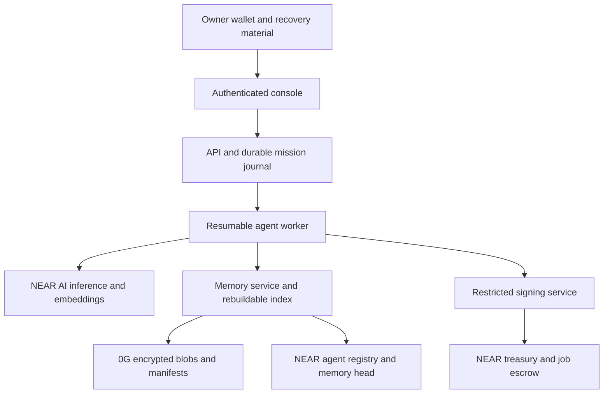

# Architecture and decisions

Planned against Sofer commit `542813f`, reviewed 2026-11-06. This document describes the target; README and plan status distinguish implemented code.

## Layers



## Authority

NEAR owns the canonical agent record: agent ID, owner, active/paused status, delegated runtime public keys and expiry, memory checkpoint version and reference, key epoch, and policy version. Do not treat a provider ID or an uploader EVM address as agent identity. Registry and treasury are modules of one authority contract, so authorization and budget reservation execute atomically. See [contract semantics and limitations](CONTRACTS.md).

Register a delegate through an owner-authorized transaction. The runtime signs with a NEAR function-call key scoped to the intended contract/methods. Because calls use the account holding the access key, contract authorization must validate the actual account and signer key, not only a claimed `agent_id` argument. Contract tests must cover two agents under one owner and cross-contract/cross-account calls. Owner-only methods are excluded from runtime key permissions.

The owner pre-funds native NEAR balances in the treasury. Function-call keys cannot attach NEAR; their allowance limits gas, not purchasing spend. Treasury storage stakes and gas reserves are accounted separately from available job funds. Contract counters include pending reservations when testing budgets.

Pausing invalidates new economic authorizations and checkpoint writes. Existing payout obligations follow the job state machine; the pause button must not be advertised as canceling already committed transfers. Revocation is contract-first and removes the access key afterward; old sessions are fenced by a generation number.

The [owner rotation coordinator](OWNER-ROTATION.md) prepares verified replacement backups, holds the canonical journals and emits immutable unsigned requests for an external owner wallet. Idempotent contract operations atomically pause/revoke/advance an epoch and later apply the explicit resume policy. Finalized account-key checks precede completion; a new-epoch write and historical recovery precede the verification receipt. Owner signing keys never enter the runtime. Planned rotation does not delay emergency pause/revocation.

## Memory protocol

`BlobRef` carries provider and network, provider-native object identifier (0G Merkle root in the live adapter), ciphertext SHA-256, and byte length. A SHA-256 digest is not the same identifier as a 0G Merkle root. Preserve both.

Use AES-256-GCM through Node's standard crypto library for the application envelope. The associated data binds schema version, agent ID, memory ID, purpose, and key epoch. Use a new random nonce per encryption. Reject wrong keys, unsupported versions, oversize records, malformed encodings, corruption, and context substitution. There is no plaintext fallback.

Each encrypted memory contains its source and revision metadata. A versioned, encrypted manifest lists record references and operation IDs. NEAR stores a public reference to the encrypted manifest and the expected checkpoint version. Sensitive metadata stays inside encrypted blobs. Public timing, size, addresses, and checkpoint frequency remain observable.

New manifests use schema 2 with an encryption epoch on each record entry. Schema 1 remains readable by inheriting the manifest epoch. Keyrings preserve historical epochs; a new manifest can use the active key without rewriting old records. Owner backup envelopes bind agent/network/contract/storage identity to a separate random recovery secret. [Recovery details](RECOVERY.md) distinguish keyring preparation from live revocation/rotation.

Commit order: encrypt and persist intent -> prepare/persist the record root -> mark upload dispatched -> upload and verify retrievability -> persist/prepare/upload the encrypted manifest -> persist the exact checkpoint attempt -> compare-and-swap the NEAR checkpoint -> wait for finality -> mark committed -> index. A failed index update never invalidates the committed source data. Never publish a head before its referenced content is retrievable.

`DurableMemoryWriter` implements this sequence with a private per-agent SQLite journal, immutable ciphertext, one pending operation and renewable fenced leases. A dispatched upload is only probed at its fixed root, never automatically uploaded again. Checkpoint attempts bind the NEAR signer's persistent journal identity; resume uses the exact request and existing nonce history. Read-only reconciliation cannot upload or submit. [Write details](MEMORY-WRITES.md) document indefinitely unknown outcomes, cancellation limits and the separate recall refresh.

Two writers use checkpoint compare-and-swap; a loser reloads the committed head and merges its append, preserving the operation ID. Same ID plus different payload is a conflict, not a success. Uploaded-but-unreferenced blobs are orphaned costs, not committed memories.

For v1, bound the manifest and memory count. The foundation uses at most 1,000 entries; the live performance spike must choose a release cap and batching policy. Chunked manifests and incremental indexes follow measured need, without changing envelope integrity or agent identity.

Recovery requires both a finalized registry head and valid owner-held decryption/recovery material. A blockchain record alone cannot decrypt anything. Recover ciphertext, authenticate the manifest and records, rebuild retrieval metadata and embeddings, and then resume. An agent transfer cannot make an old owner forget old keys; cross-owner transfer is deferred.

## Index and inference

The search index is an expendable cache, scoped by agent and key epoch. Use full-text retrieval plus vector search where justified. Plaintext/vector indexes run only in the trusted owner-controlled runtime in v1. Remote index deployment requires an explicit updated threat model; embeddings can leak information.

The implemented first cache uses local SQLite FTS5 with atomic replacement of a fully authenticated snapshot. Reads require the expected finalized head, verify cache integrity, preserve revision history and mark content untrusted. Keyword recall and durable write intents are implemented; embeddings and full live-provider recovery remain release gates.

NEAR AI supplies inference and embeddings through provider adapters. Use a currently available TEE-hosted model for private-inference claims. The project now pins an isolated Node 24.22.2 runtime compatible with the SDK's documented requirement of Node >=24.22.1. Offline evidence validation is implemented; live private inference remains unverified until credentials, credits and a working model/evidence flow are tested. Do not silently replace verification with an API success check.

Verified inference evidence is not proof that a tool ran correctly, a report is true, or a job was worth paying. Capture only the evidence actually provided and verified. Never store model chain-of-thought as an application receipt.

## Execution and external effects

An action has a stable operation ID, canonical request digest, policy version, authorization generation, attempt count, and external reference. Persist intent before an external effect, then persist its observed outcome. States distinguish `queued`, `authorized`, `submitted`, `unknown`, `confirmed`, `failed`, and `canceled`. Unknown transactions are reconciled using their recorded transaction hash/nonce before retrying. Do not claim exactly-once external execution; implement deduplication and reconciliation.

The mission journal is SQLite with explicit migrations for a single operator deployment. One process owns writes; background workers use leases plus fencing tokens and stop on lease loss. Persist event cursor before acknowledging it. API/UI projections rebuild from journal records. A separate signer service holds runtime signing keys; no owner key or uploader key is available to model-visible tools.

## Commerce

Use one native asset and a curated specialist for v1. Quotes bind buyer, agent, worker, artifact criteria hash, amount, asset/network, expiry, and operation ID. Worker envelopes are signed and include sequence, recipient, and expiry. Shared keys are not derived by concatenating private and public keys.

Contract lifecycle: `funded -> delivered -> payout_pending -> paid`; a failed transfer becomes `payout_failed` and can be retried to the original worker. Cancellation/expiry returns funds internally to the treasury and records `refunded`; a separate owner withdrawal uses a transfer/callback. Delivered work can become `disputed`, with an owner-mediated all-pay/all-refund resolution and a seven-day refund timeout. Unchallenged delivery becomes payable after its review deadline. This dispute policy trusts the buyer and does not provide impartial arbitration. Workers cannot replace a delivered artifact reference or payout recipient. See [exact deadlines and settlement rules](CONTRACTS.md#deadlines-and-settlement).

For daily limits, count each reservation against its UTC window. Refunds return balance but do not reset that window's allocation counter in v1; document this conservative policy. Use integer base units, checked arithmetic, and bounded storage growth.

## Repository layout

```text
apps/console/                 browser product (plan 006)
apps/api/                     authenticated API (plan 005)
apps/worker/                  mission runner (plan 005)
packages/protocol/            schemas, ports, structured errors
packages/crypto/              authenticated envelopes
packages/memory/              manifests, recall, recovery
packages/storage/             local development and live 0G adapters
packages/near/                registry/treasury clients and event reconciliation
packages/inference/           NEAR AI adapters and evidence verification
packages/runtime/             journal, leases, action execution
contracts/authority/          Rust NEAR registry and treasury modules
contracts/integration-tests/  deployed-WASM NEAR sandbox scenarios
tests/                        cross-boundary invariant tests
docs/                         product, architecture, trust, evidence
plans/                        implementation order and done criteria
```

Create directories when they contain actual implementation. Empty directories and placeholder methods are not shipped capabilities.
