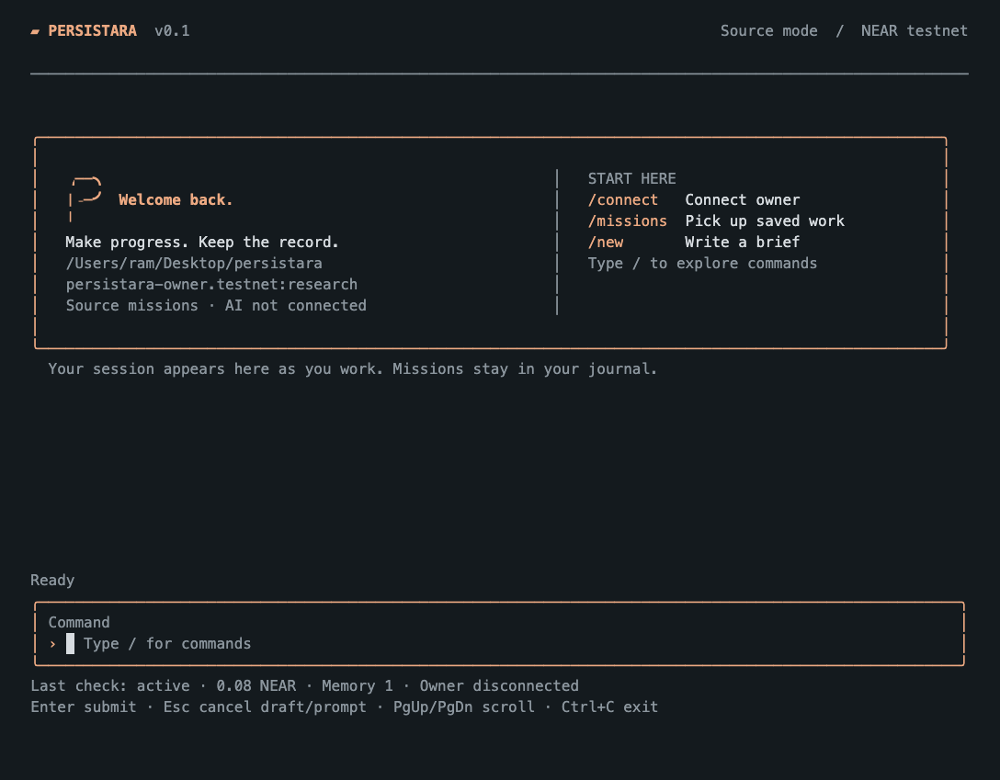

# Persistara terminal

The terminal is now the primary operator workspace. It uses the same owner, mission, commission and recovery services/journals as the console, directly in the local process. It needs no browser or NEAR AI credits for source missions, review, status, keyword recall or recovery. The web interface remains available; visual redesign is deferred.

This release provides a real interactive command workspace, not AI conversation. Model chat/reasoning, conversational transcript resumption, a new-agent enrollment wizard, daemon lifecycle and Telegram are not implemented yet. Ordinary text does not receive a fabricated model response.

## Start

In the existing configured checkout, use Node 24.22.2 / pnpm 10.26.0:

```sh
cd /Users/ram/Desktop/persistara
pnpm install --frozen-lockfile
pnpm build
./bin/persistara
```

After the initial build, `pnpm cli` opens the same terminal immediately. Use `pnpm cli:dev` to rebuild after source changes. The executable prefers the project's pinned Node runtime. The workspace's `nodeVersion` matches its installed `devEngines.runtime`, so engine checks use the script runtime rather than the host shell's Node version ([pnpm settings](https://github.com/pnpm/pnpm.io/blob/main/versioned_docs/version-10.x/settings.md#nodeversion)). Global Node and shell configuration are unchanged. The executable is project-local; no global package installation is claimed. To use it from elsewhere, run its absolute path. Its default workspace is its own checkout, not the shell's current directory. `--project /absolute/path` explicitly selects another configured workspace. All global flags precede the command.

An interactive TTY now opens the full terminal application: a welcome/workspace view, persistent input composer, command picker, scrollable session output, last-checked status strip and elapsed working indicator. This uses pinned Ink/React over the same command/services engine; it is not a second agent runner. The application uses an alternate terminal screen and restores the original shell on exit.

Type `/` to open commands. Up/Down selects a suggestion; Tab fills it; Enter runs a command or fills an argument-taking command for you to finish. Inside a form or review, the composer accepts only that response; selecting a command never approves a review. `/help`, `/help missions`, `/help specialist`, `/help memory`, `/help controls` and `/help all` retain their existing meanings.

- PgUp/PgDn scroll session output, including complete dossier and review fields that do not fit in the viewport.
- Left/Right, Home/End and Backspace/Delete edit input with Unicode grapheme boundaries. Ctrl+A/E moves to the start/end; Ctrl+U/K/W edits the draft.
- Escape dismisses the command picker, clears a command draft, or cancels the current form/review response. Ctrl+C stops owned work and exits safely. Ctrl+D on an empty command composer closes normally.
- Up/Down outside the command picker recalls only commands typed in this process. Form and approval responses are excluded. Ctrl+L clears the visible session, never the durable journal.
- Paste is one bounded input value. Pasted newlines do not submit or queue commands/approvals. Input during active work is ignored rather than queued.

Use `./bin/persistara --plain` for the readline interface. `TERM=dumb`, `INK_SCREEN_READER=true` and non-TTY interactive QA use the plain path automatically; structured/JSON/operator commands retain their existing output. `NO_COLOR` keeps the application with uncolored text. All untrusted content is escaped before rendering. The welcome view and in-memory command/session history disappear on exit; durable missions remain in their journal and conversational transcript recovery is not implemented.



[Command-picker capture](images/terminal-commands-2026-11-09.png). These are terminal-emulated captures of the real application against the configured public workspace, not browser-wallet or inference evidence.

The existing `.env` must provide the public NEAR deployment/owner/agent/runtime identity, separate signer/uploader settings and local recovery paths documented in [integration setup](INTEGRATIONS.md). Missing settings fail without fixtures. Build the checked authority WASM with `pnpm contract:build` if absent; authority reads pin the deployed code to that artifact. Source collection uses only the configured approved public HTTPS origins.

`./bin/persistara init` checks the **existing** configuration/readiness. It does not create an account, register an agent, install a runtime key or fund a treasury. New-agent enrollment remains separate work. `--help` and the explicit unavailable `chat` response work without loading the workspace.

## Complete a source mission

In the command composer, or the `persistara>` prompt with `--plain` (a leading slash is optional):

1. `/connect` shows the original-owner account, network, agent/contract, exact original public key and off-chain session purpose. Type `details` to inspect the complete NEP-413 message/domain/digest before deciding, then `connect` to approve the message signature or Enter to cancel. Inspecting details does not approve it. The installed official NEAR CLI uses its external keychain; no owner private key or seed phrase enters Persistara. `NEAR_CLI_BIN` selects that trusted executable, for example `/opt/homebrew/bin/near`.
2. `/new` prompts for title, objective, review criteria and one to six approved source URLs. The immutable brief receives a durable mission ID before execution. No upload, inference or payment occurs.
3. `/run` captures the selected mission's remaining sources. `/run mission:UUID` or `/resume mission:UUID` selects an existing mission. Completed source captures are retained and skipped. Ctrl+C/SIGTERM stops this terminal and interrupts owned source work gracefully; a hard crash may require the existing 60-second lease to expire before resumption.
4. Inspect the source excerpts, dates, SHA-256 fingerprints and review criteria. Captures are labeled untrusted; collection is not proof of correctness.
5. `/review` displays the exact dossier again and asks you to type `review`. The saved artifact digest binds the local review. This does not pay anyone.
6. `/exit` disconnects and closes the owned local worker/journals. Open another terminal, reconnect and use `/open mission:UUID` or launch with `./bin/persistara --resume mission:UUID`. The flag selects saved work; it does not automatically rerun it or restore an AI conversation.

`/missions`, `/status` and `/activity` show saved work, finalized authority/budgets and durable events. In the interactive list, `/open 1` selects the first displayed mission; `/run 1` and `/commission 1 0.01` also accept the displayed number. Numbers retain their displayed mission ID until the next `/missions` refresh; they are not durable IDs or accepted by structured commands. Full IDs remain available in `/open` details and structured JSON. `/cancel` cancels local source work before review. A source mission linked to a commission cannot bypass its commerce lifecycle through these local buttons/commands.

The shared local workspace retries a temporary RPC read at most once against the same configured endpoint, with 200 ms backoff and an 8-second timeout per attempt. Only `status`, `block` and `query` can use this policy. Malformed JSON/envelopes and integrity failures do not retry; transaction submissions, wallet signing and uploads do not retry. Readiness still requires matching finalized scope/code/keys. Exhausted reads stop the command and show a connection check hint. A later provider outage can still prevent login; no cached authority or fabricated success replaces a fresh check.

The owner login uses a CLI-specific recipient domain bound to chain, contract and agent. It cannot be replayed as the web host's login. Sessions last ten minutes in memory; restarting or disconnecting requires a new proof. No session token, signature proof, prompt history or wallet secret is written to a CLI credentials file. Briefs and dossiers remain in the existing private mission journal.

## Commission and inspect specialist work

From a queued selected mission:

```text
/commission 0.01
/export-request /private/new/task.json
```

This creates a separate local buyer recipient key if needed and prepares the encrypted request; it does not upload or reserve funds. The key is outside the memory-only backup. Include it in the [portable owner kit](RECOVERY-KIT.md) and verify custody before relying on encrypted deliveries.

Use `persistara specialist quote ...` in the separate worker configuration as described in [the signed-file workflow](COMMISSIONS.md), then:

```text
/quote /private/signed/quote.json
/reserve
```

Reservation review displays the exact worker, integer yoctoNEAR amount, network, quote digest, delivery/review deadlines, buyer-controlled dispute terms, delivery-key custody and 0.01 testnet 0G upload ceiling. Type `reserve` only after review. This uploads the fixed encrypted brief and reserves the fixed purchase amount; runtime gas is separate. It does not pay the specialist.

After the worker fulfills/delivers the same job:

```text
/delivery /private/signed/delivery.json
/open mission:UUID
/settle
/reconcile
/receipt
```

Delivery verification checks signatures, full scope/request, finalized immutable result, 0G proof/digest/length, JWE authentication and original brief/source bindings. The terminal previews decrypted source content before settlement review. Type `settle` to acknowledge the exact artifact and quote. Only finalized callback state `paid` completes payment; accepted/pending is not paid. `/receipt` displays fingerprints, public transaction hashes, review digests and payout attempt without dumping private key material.

Uncertain uploads/reservations/acceptances only reconcile the same roots/operations. An already reviewed acceptance is not dispatched again. Never delete markers, replace journals, invent operation IDs or re-encrypt/re-upload to clear an unknown result. Cancellation/refunds/disputes and failed-transfer recovery retain the limits documented in [commerce](COMMISSIONS.md).

## Memory and recovery

`/memory-recover` uses the existing owner memory backup and public NEAR/0G reads to rebuild the canonical private recall cache. `/memory dated primary sources` recalls source-bearing untrusted records at the finalized head. These operations do not invoke embeddings or inference. Restored caches are plaintext in the trusted private runtime directory.

The single entry point also exposes the existing operator commands:

```sh
./bin/persistara recovery verify --kit /path/owner.kit \
  --secret-file /separate/private/kit.secret --expect-sha256 EXPECTED_FINGERPRINT

./bin/persistara memory recover --bundle /private/memory.bundle \
  --secret-file /separate/private/recovery.secret --state-dir /private/cache

./bin/persistara --acknowledge-costs memory write --keyring /private/keys.json \
  --state-dir /private/canonical-memory --input-file /private/remember.json
```

Forwarding routes use fixed program paths and argument arrays, never a shell evaluator. Memory write/resume and specialist fulfill/deliver/retry-payout require explicit `--acknowledge-costs`; they retain their own canonical journals and bounded effects. Offline recovery-kit verify/recover forwarding does not load the original `.env` in the parent or child. Physical off-device verification remains a separate observed property; the terminal never infers it from another folder or hostname.

`persistara doctor` runs storage-only diagnostics by default. No AI credits are used. Sensitive material is never accepted as an inline command-line key/secret value; recovery commands take protected file paths.

## Conversation sessions (offline core)

Ordinary text that is not a command goes to a durable conversation session. **It is disabled by default**: with no opt-in the terminal prints an AI-not-enabled message, makes zero provider calls, opens no wallet and writes nothing. An API key alone never enables it; live use needs `PERSISTARA_AI_CHAT=enabled` plus `NEARAI_API_KEY` and a verified TEE `NEARAI_MODEL`. Live inference, attestation, tool calling and cost limits have **not** been accepted; do not enable it until that separate check is authorized.

- Routing: a leading `/` is always an operator command (unknown slash commands are errors). A bare word is a command only when it is a documented command and its arguments fit (`status`, `open 1`, `help memory`, `memory rent`); anything else (`what's my status?`) is conversation. Answers to approval/form questions are never routed.
- `/sessions` lists saved conversations, `/session new` starts one and `/session open <number|ID>` reopens it with its history. The composer shows the selected session. `--resume <mission-id>` still selects a **mission** only.
- Limits per message: 4 model rounds, 4 tool calls per round, 1,024 output tokens per call, 128 messages / 256 KB request. An over-cap tool batch runs nothing; a `length` finish is shown as partial; an over-long session reports a context limit and never silently drops history.
- Tools: only `mission_list`, `mission_detail` and `memory_recall`, all read-only, re-authorized against the original owner on every call, results bounded to 16 KB and marked untrusted. There is no command, fetch, filesystem, upload, payment, pause, rotation or memory-write tool.
- Lost outcomes: each request is journaled before dispatch. If the process exits, times out or is canceled after dispatch, the attempt becomes **outcome unknown**, the session is fenced and the request is never resent automatically; it may have been billed (cost is never recorded as zero). Start `/session new` to continue.
- Custody: sessions are private plaintext in `.persistara/conversations/research/conversations.sqlite` (0700/0600). They are **not** committed memory, are not encrypted to 0G and are **not** in the memory backup or portable kit.

## Structured commands and approvals

For scripts, put `--json` and global consent flags **before** the command:

```sh
./bin/persistara --json status
./bin/persistara --approve-login --json missions
./bin/persistara --approve-login --json mission create --file /private/brief.json
./bin/persistara --approve-login --json mission resume mission:UUID
./bin/persistara --approve-login --json commission show commission:UUID
```

The mission JSON must include a stable UUID `requestId`, `title`, `objective`, `criteria` and `sources`. Reusing that file retains the request identity; changed content under the same ID fails. `--approve-login` consents only to an off-chain original-owner message signature. It cannot authorize funds or gas.

`commission show` exposes separate `reviews.reservation` and `reviews.settlement` digests. Native financial commands require the matching `--approve-digest` **and** `--acknowledge-costs`; the settlement digest commits to both quote and artifact. Local mission review instead uses the artifact digest and costs no funds:

```sh
./bin/persistara --approve-login --approve-digest EXACT_ARTIFACT_SHA256 --json \
  mission review mission:UUID

./bin/persistara --approve-login --approve-digest EXACT_RESERVATION_REVIEW_DIGEST \
  --acknowledge-costs --json commission reserve commission:UUID
```

Replace the uppercase placeholders with fingerprints you inspected independently. Never copy a review digest from untrusted source prose. The services recheck scope/session/authority, version and exact request after review, immediately before effects.

`--json` emits one result on stdout; errors go to stderr. Exit codes: **0** completed command/observation; **1** invalid/failed/canceled native action; **2** missing configuration or an interactive terminal required; **3** an existing effect remains pending/unknown and needs observation; **130** terminal interruption. Read-only `show` succeeds even when the observed job is pending. Forwarded operator commands retain their documented exit codes. Exit 3 never authorizes a replacement effect.

## Owner controls

`/pause` and `/resume-agent` prepare exact zero-deposit `set_paused` requests and show the original owner/key, contract, digest and maximum 100 Tgas before external signing. Gas costs testnet NEAR. The canonical owner journal records wallet handoff first. A wallet failure/cancellation or missing hash remains unresolved and cannot be sent again.

For a structured review, `owner prepare pause` or `owner prepare resume` creates/reuses the unsubmitted request and exposes its digest. Then the exact digest/cost consent can authorize `owner pause`/`owner resume`. A declined interactive review cancels only an unsubmitted request. Use `/owner-reconcile wallet:UUID TRANSACTION_HASH` to verify the fixed finalized public receipt or `/owner-cancel wallet:UUID` before handoff. The external CLI's returned hash is only a candidate; the same service verifies actual signer/key/action/args/gas/zero deposit/nonce/final result as the console. A missing/unsupported wallet hash can remain unknown indefinitely.

Pausing stops new runtime spending/checkpoints while preserving existing obligations. Native owner controls do not import/export a wallet, rotate registration ownership or complete a new-agent enrollment workflow.

## Verification boundary

Tests cover exact original-owner login, wrong keys/expiry/authority changes, durable mission reopen, interrupted remaining-source resume, signed quote/delivery review, denied/uncertain economic effects, callback-aware payout status, retained owner-wallet handoffs, explicit consent, terminal escape/bidi injection and offline routing. Browser regressions validate the shared setup without redesigning the page. Fixture tests remain explicitly labeled and separate from real CLI acceptance evidence. No inference quality, audited production custody, browser-provider approval or physical off-device claim is implied by a working terminal.

The 2026-11-08 native acceptance connected the real original owner, listed existing missions and rebuilt the committed memory cache without uploading. An actual CLI process then stopped after the first saved public-source capture and exited 130; a fresh process completed the remaining source, reviewed the exact dossier and reopened it with the same digest. Both sources have one capture attempt. No inference, 0G upload or public transaction was used. See [sanitized native acceptance evidence](evidence/native-terminal-2026-11-08.json). Local checks pass 220 TypeScript tests / 33 suites, 11 browser tests, 34 Rust tests and six deployed-WASM sandbox scenarios.
